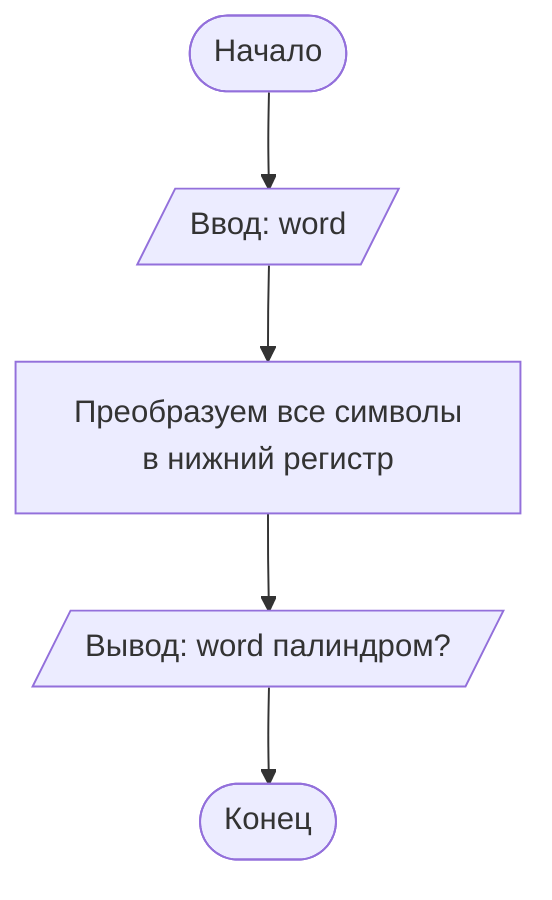

# A3  

    💡 Напиши **без использования `if`** (только срезы и `==`):

#### > Пользователь вводит слово. Проверь, является ли оно **палиндромом** (читается одинаково в обе стороны). Выведи `True` или `False`.
     **Подсказка:** `s == s[::-1]`.

# Словесный алгоритм:
1. Запросить ввод слова
2. Преобразовать все символы слова к единому регистру
3. Вывести введённое слово и является ли оно палиндромом

## Блок-схема:

