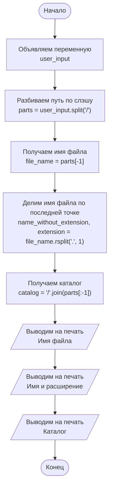

**B5.** 💡 Пользователь вводит путь к файлу, например `"/home/nach101/report.csv"`. Выведи:
 - имя файла (`"report.csv"`)
 - расширение (`"csv"`)
 - имя без расширения (`"report"`)
 - каталог (`"/home/nach101"`)

**Подсказка:** `.split("/")`, `.rsplit(".", 1)`, `"/".join(...)`.

## Словесный алгоритм
1. Объявляем переменную, имитирующую ввод пользователя (раз она нам в задании дана)
2. Разбиваем путь по "/" с помощью ,split("/") и сохраняем в переменную parts (части)
3. Имя файла - это последний элемент [-1]
4. Делим имя файла по последней точке rsplit(".", 1). Получаем отдельно имя и расширение. Раскладываем их в отдельные переменные
5. Каталог - это все части пути кроме последней. Сединяем их "/".join(parts[:-1])
6. Выводим на печать результаты

### Блок-схема

