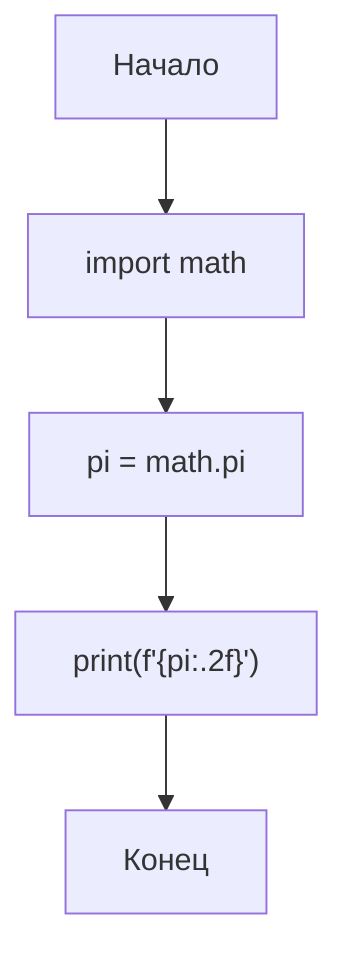

# Задача 1.1. Вывод π с точностью до сотых

## Условие
> Вывести на экран число π с точностью до сотых.

## Словесный алгоритм
1. Импортировать модуль `math`.
2. Получить значение π через `math.pi`.
3. Вывести через `print()` с форматом `.2f`.

## Блок-схема

## Методы решения
- v1: через `math.pi` + f-строка `.2f`
- v2: через `round(math.pi, 2)`
- v3: через `format(math.pi, '.2f')`

## Контрольный пример
| Вход | Ожидаемый выход |
|------|-----------------|
| —    | 3.14            |
