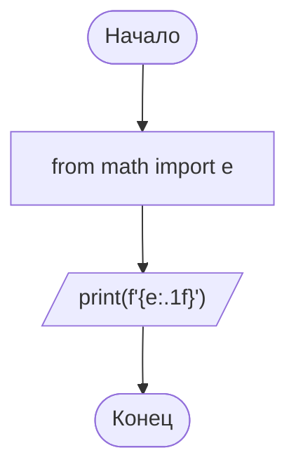

# Задача 1.2. Вывести на экран число e

## Условие
> Вывести на экран число е с точностью до десятых

## Словесный алгоритм
1. Импортировать КОНСТАНТУ через `from math import e`.
2. Вывести через `print()` с форматом `.1f`.

## Блок-схема

