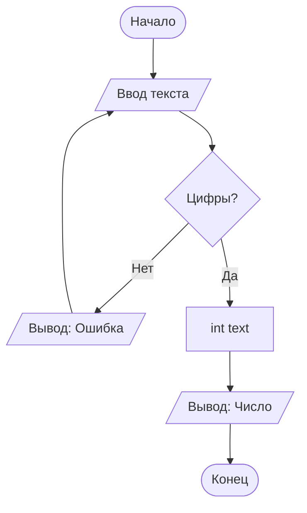

# Задача 1.4 Составить программу вывода на экран числа, вводимого с клавиатуры.

## Условие
> Выводимому числу должно предшествовать сообщение "Вы ввели число".

## Словесный алгоритм
1. Запросить у пользователя ввод числа
2. Проверить ввод (усложнение): если не цифры — сообщить об ошибке и повторить.
3. Вывести на экран при помощи f-строки "Вы ввели число {num}"

## Блок-схема

