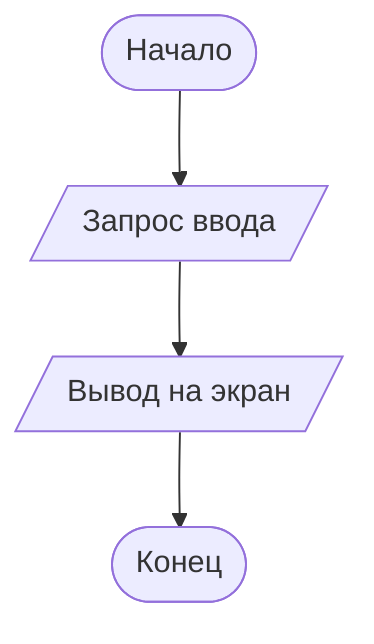

# Задача 1.4. Составить программу вывода на экран числа, вводимого с клавиатуры.

## Условие
> После выводимого числа должно следовать сообщение " - вот какое число Вы ввели".

## Словесный алгоритм
1. Запросить у пользователя ввод числа
2. Вывести на экран сообщение " Число - вот какое число Вы ввели"

## Блок-схема

