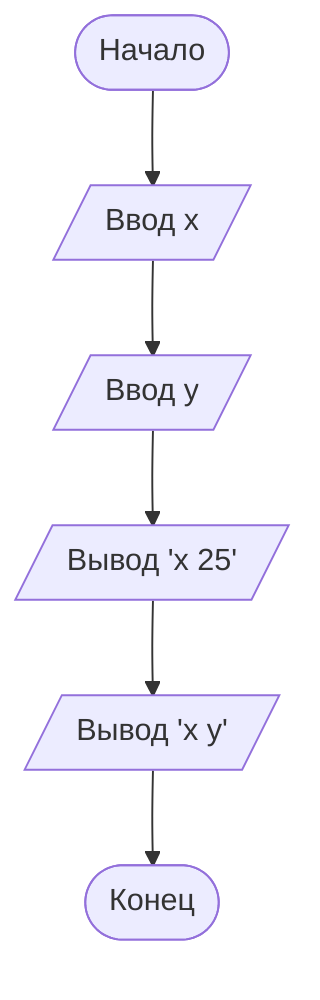

# Задача 1.12. Составить программу вывода на экран следующей информации:
в)  x 25
    x y
>Примечание: x и y — переменные целого типа, значения которых вводятся с 
>клавиатуры и должны быть выведены вместо имен величин.

## Словесный алгоритм
1. Запрашиваем у пользователя ввод значения 'x'
2. Запрашиваем у пользователя ввод значения 'y'
3. Выводим на экран с помощью f-строки x 25
3. Выводим на экран с помощью f-строки x y

## Блок-схема

