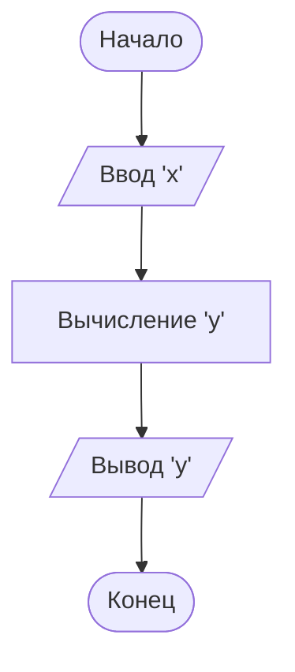

# Задача 1.22
## Условие:
    Составить программу:
    вычисления значения функции y = 7x² - 3x + 6 при любом значении x;
    вычисления значения функции x = 12a² - 7a + 16 при любом значении a

## Словесный алгоритм
1. Раз при любом значении 'x' ('a'), то нужно запросить это значение у пользователя.
2. Вычисляем значение 'y' ('x')
3. Выводим на экран результат вычисления 'y' ('x') при значении 'x' ('a')

## Блок-схема

