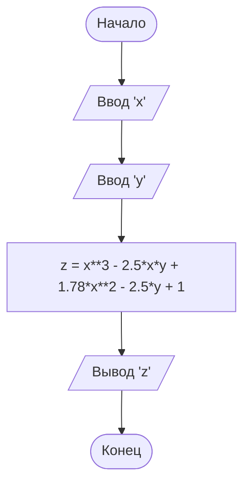

# Задача 1.30а.
## Условие
    Составить программу вычисления значения функции:
    z = x^3 - 2.5xy + 1.78x^2 - 2.5y + 1
    при любых значениях x и y.

## Словесный алгоритм
1. Запросить ввод значения 'x'
2. Запросить ввод значения 'y'
3. Вычислить значение 'z'
4. Вывести на экран значение 'z' при 'x' и 'y'

## Блок-схема

