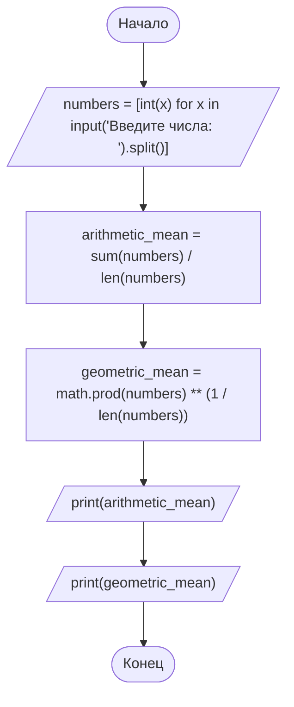
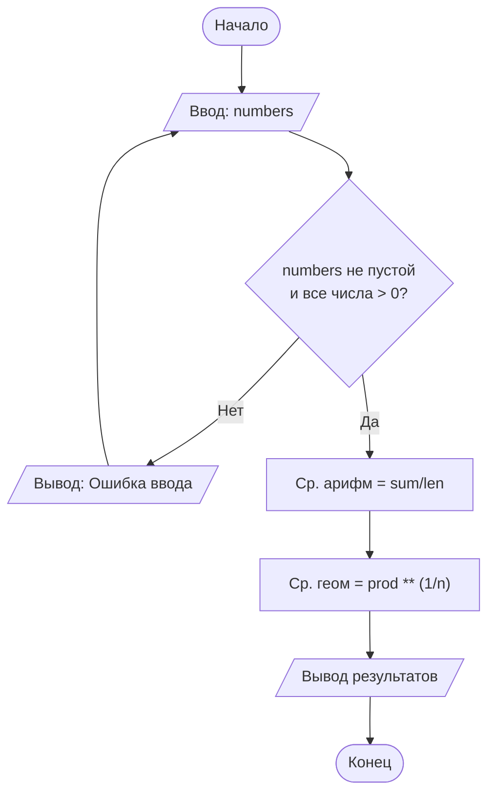

# 📌 Задача 1.31
## Условие
    Даны два целых числа. Найти:
    а) их среднее арифметическое;
    б) их среднее геометрическое.

- Среднее арифметическое двух чисел a и b — это их сумма, делённая на 2
- Среднее геометрическое двух чисел a и b — это квадратный корень из их 
  произведения 

#### Словесный алгоритм
1. Импортируем модуль math
2. Запрашиваем **целые положительные** числа (для усложнения любое количество чисел) используя numbers = [int(x) for x in input("Введите числа: ").split()]
3. Вычисляем среднее арифметическое
4. Вычисляем среднее геометрическое
5. Выводим среднее арифметическое 
6. Выводим среднее геометрическое

# Блок-схема:

______________________________________________________________________________

#### Вариант с проверкой ввода
______________________________________________________________________________

