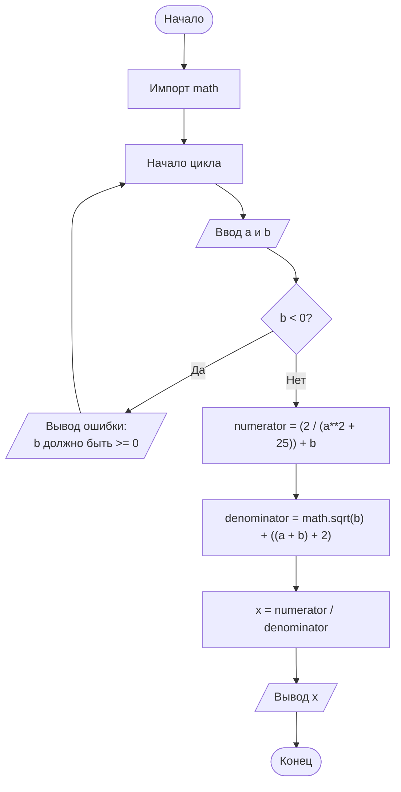

# Задача 1.40.
## Условие
    Составить программу расчета значения функций:
    x=(2/(a**2+25))+b / sqrt(b)+((a+b)+2)

## Словесный алгоритм
1. Импортируем библиотеку math 
2. Запросить ввод значения 'a'
3. Запросить ввод значения 'b'
4. Вычислить числитель выражения (т.к. выражение сложное, разобъём его)
5. Вычислить знаменатель выражения
6. Вычислить значение 'x'
7. Вывести на экран значение 'x' при 'a' и 'b'

## Блок-схема

