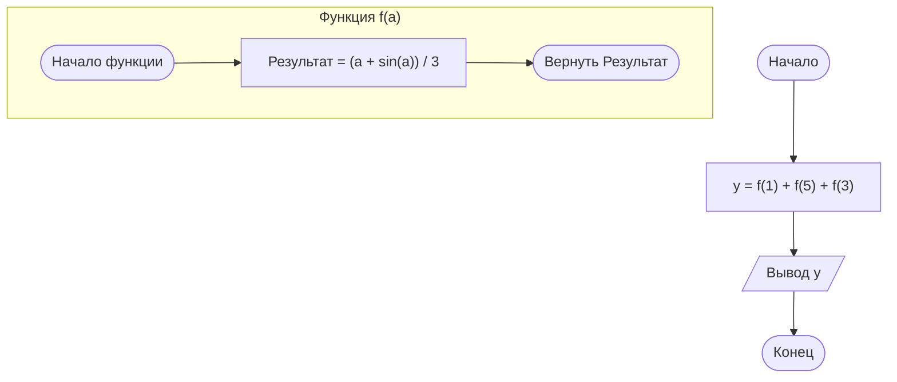

# Задача 10.2:

    Рассчитать значение y, определив и использовав необходимую функцию:
    а) y = (1 + sin(1)) / 3 + (5 + sin(5)) / 3 + (3 + sin(3)) / 3

## Словесный алгоритм:

    Каждое из трёх слагаемых вычисляется по абсолютно одинаковому математическому принципу, меняется только числовое значение (\(1\), \(5\) и \(3\)). Это значит, что можно выделить общую вспомогательную функцию вида:
    (a + sin(a)) / 3
    Тогда искомое значение выражения можно записать как сумму трёх вызовов этой функции с разными аргументами: y = f(1) + f(5) + f(3).
1. Описать вспомогательную функцию f(a), принимающую вещественное число (a).
2. Внутри функции вычислить значение выражения (a + sin(a)) / 3) и вернуть результат.
3. В основной программе вызвать функцию f(a) трижды: для аргументов (1), (5) и (3).
4. Сложить результаты этих трёх вызовов и сохранить сумму в переменную (y).
5. Вывести значение переменной (y) на экран.

### Блок-схема:

