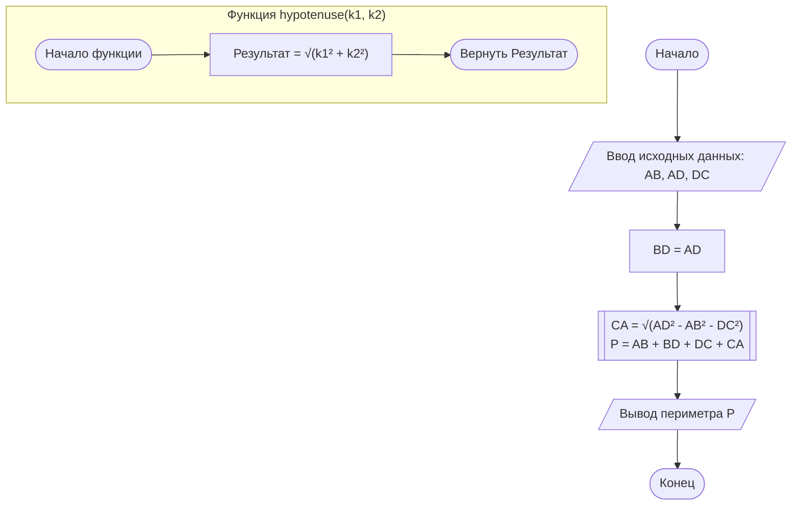

# Задача 10.6 (по задачнику Златопольского):

## условие:

    Найти периметр фигуры ABCD по заданным сторонам AB, AD и DC. (Определить функцию для расчета гипотенузы 
    прямоугольного треугольника по его катетам).

    Подсказка: фигура состоит из двух прямоугольных треугольников (ABD и BCD). Гипотенузы — это стороны BD и BC 
    (если ABCD — это четырехугольник, как на рис. 10.1). Вам нужно вычислить BD по катетам AB и AD, а BC — по катетам CD и BD. 
    Функция для гипотенузы — это теорема Пифагора.


### Словесный алгоритм

    1. Создать вспомогательную функцию hypotenuse(k1, k2), принимающую два вещественных числа (катета) и возвращающую 
       гипотенузу по формуле: \(\sqrt{k1^{2}+k2^{2}}\).
    2. В основной программе запросить у пользователя или задать три известные стороны: AB, AD и DC.
    3. Принять, что для данной геометрической конфигурации сторона BD равна стороне AD (BD = 11).
    4. Вычислить длину неизвестной стороны CA математически через разность квадратов: \(\sqrt{AD^{2}-AB^{2}-DC^{2}}\).
    5. Рассчитать итоговый периметр фигуры, сложив длины сторон по запрашиваемому контуру: P = AB + BD + DC + CA.
    6. Вывести полученный результат P на экран.

#### Блок-схема



```python
import math

# 1. Определение функции для расчета гипотенузы по двум катетам
def hypotenuse(k1, k2):
    """Возвращает гипотенузу по двум катетам."""
    return math.sqrt(k1**2 + k2**2)

# 2. Исходные данные
AB = 5.0
AD = 11.0
DC = 4.0

# 3. Нахождение стороны BD (гипотенуза в треугольнике ABD)
BD = hypotenuse(AB, AD)

# 4. Нахождение стороны CA (катет в треугольнике ACD)
# Из теоремы Пифагора: AD^2 = CA^2 + DC^2  =>  CA^2 = AD^2 - DC^2
CA = math.sqrt(AD**2 - DC**2)

# 5. Расчет периметра
P = AB + BD + DC + CA

# 6. Вывод
print(f"Сторона BD (гипотенуза): {BD:.3f}")
print(f"Сторона CA (катет): {CA:.3f}")
print(f"Периметр фигуры P: {P:.3f}")
```


