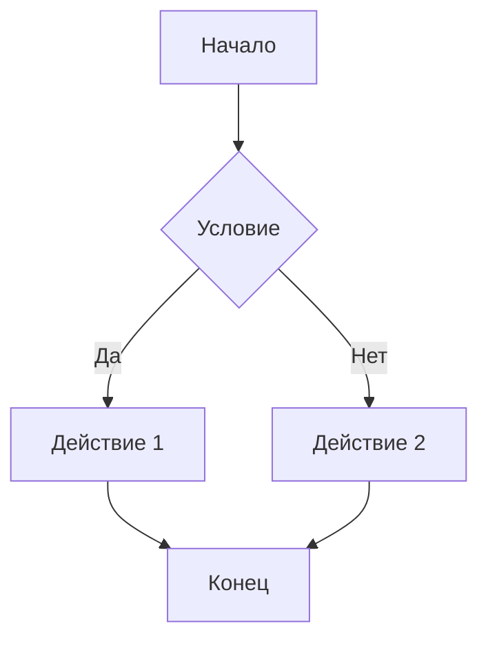

 Шпаргалка по Markdown

Для чего: ведение дневника, заметок, конспектов в .md-файлах.
Где работает: GitHub, GitVerse, Neovim (с mdkite.nvim), Obsidian, VS Code, Telegram (частично).
1. Заголовки
markdown

# Заголовок 1 (H1)
## Заголовок 2 (H2)
### Заголовок 3 (H3)
#### Заголовок 4 (H4)

В дневнике: используем эмодзи + текст вместо #, чтобы было красиво:
markdown

📖 День 31 — 21.10.2026 (среда)

❤️ Семья

📚 Учёба (Python)

    Правило: после заголовка — пустая строка.

2. Абзацы и переносы строк
markdown

Это первый абзац.

Это второй абзац (между ними пустая строка).

Перенос внутри абзаца — два пробела в конце строки или <br>:
markdown

Первая строка.  
Вторая строка (после двух пробелов).

    Правило: абзацы разделяются пустой строкой.

3. Списки
Маркированный
markdown

- Пункт 1
- Пункт 2
  - Вложенный пункт (2 пробела)
    - Ещё глубже (4 пробела)

Нумерованный
markdown

1. Первый
2. Второй
3. Третий

Чек-лист (задачи)
markdown

- [x] Сделано
- [ ] Не сделано

Результат:

    ☑

    Сделано
    □

    Не сделано

4. Выделение текста
markdown

**Жирный** (две звёздочки)
*Курсив* (одна звёздочка)
***Жирный курсив*** (три)
~~Зачёркнутый~~ (две тильды)
`код` (одна обратная кавычка)

Результат: Жирный, Курсив, Жирный курсив, ~~Зачёркнутый~~, код.

    В дневнике: жирным — важное (вес, ключевые события), курсивом — мысли, кодом — команды и имена файлов.

5. Код
Инлайн (в строке)
markdown

Запустить `python solution.py` в терминале.

Результат: Запустить python solution.py в терминале.
Блок кода
markdown

```python
def hello():
    print("Привет!")
```

Результат:
python

def hello():
    print("Привет!")

С указанием языка (для подсветки): python, bash, markdown, mermaid, text.

    Важно: для обычного текста не используйте обратные кавычки — это код-инлайн.

6. Ссылки
markdown

[Текст ссылки](https://example.com)
[Ссылка с подсказкой](https://example.com "Подсказка")

Результат: Текст ссылки

Автоссылка:
markdown

<https://example.com>

Результат: https://example.com
7. Изображения
markdown


Результат: вставится картинка.

    В дневнике: можно вставлять фото блюд, скриншоты анализов, схемы.

8. Цитаты
markdown

> Это цитата.
> 
> Второй абзац цитаты.

Результат:

    Это цитата.

    Второй абзац цитаты.

В дневнике: цитаты Лены, слова любимой, важные мысли.
9. Горизонтальная линия
markdown

---

Результат: горизонтальная линия (разделитель).

    В дневнике: разделитель между днями.

10. Таблицы
markdown

| Время | Действие |
|---|---|
| 6:00 | Подъём |
| 6:10 | Зарядка |
| 7:00 | Проводить Лену |

Результат:
Время	Действие
6:00	Подъём
6:10	Зарядка
7:00	Проводить Лену

Выравнивание:
markdown

| Слева | Центр | Справа |
|:---|:---:|---:|
| a | b | c |

    В дневнике: распорядок дня, динамика веса, анализы.

11. Эмодзи
markdown

❤️ ❤️ ❤️
📖 📚 📝
🏓 🏋️ 🚶
🍽️ 🍲 🥚
📊 📈 📉
💊 🩺 🏥
🎯 ✅ ❌

Где брать: emoji-cheat-sheet или в Neovim — :Emoji (если плагин).

    В дневнике: эмодзи — для разделов (❤️ Семья, 📚 Учёба, 🏓 Спорт, 🍽️ Питание, 📊 Вес, 💊 Здоровье).

12. Экранирование (если нужно показать символ)
markdown

\*не курсив\*
\`не код\`
\# не заголовок

Результат: *не курсив*, `не код`, # не заголовок.
13. Mermaid (блок-схемы)
markdown



Результат: блок-схема (в mdkite.nvim — через <leader>mk).

Основные фигуры:

    В дневнике: алгоритмы задач по Python.

14. Сноски
markdown

Текст со сноской[^1].

[^1]: Текст сноски.

Результат: Текст со сноской[^1].
[^1]: Текст сноски.
15. HTML (если нужно)
markdown

<b>Жирный</b>
<br> — перенос строки
<details>
<summary>Спойлер</summary>
Скрытый текст.
</details>

Результат: <b>Жирный</b>,
— перенос, <details><summary>Спойлер</summary>Скрытый текст.</details>

    В дневнике: редко, но можно для сворачиваемых блоков (например, длинные анализы).

16. Правила для дневника (наши)

    Заголовок дня: 📖 День N — дата (день недели).

    Разделы: ❤️ Семья, 📚 Учёба, 🏓 Спорт, 🍽️ Питание, 📊 Вес, 💊 Здоровье, 📝 Заметки.

    После заголовка — пустая строка.

    Списки — с -.

    Жирный — для важного (вес, ключевые события).

    Код — для команд, имён файлов.

    Таблицы — для распорядка, веса, анализов.

    Mermaid — для алгоритмов.

    Без тильды для обычного текста (тильда — только для кода).

    Разделитель --- между днями.

17. Пример: запись дня (шаблон)
markdown

📖 День N — ДД.ММ.ГГГГ (день недели)

❤️ Семья

Утро по плану. Лена ушла на работу. Вечером — ужин вместе.

📚 Учёба (Python)

- Задачник Златопольского: задача N.MM — закрыта.
- Метод: разбор → алгоритм → Mermaid → код.

🏓 Спорт

- Зарядка 10 мин.
- Спортзал (настольный теннис).

🍽️ Питание

- **Завтрак:** ...
- **Обед:** ...
- **Ужин:** ...

📊 Вес

- Утро: XX,X кг (ИМТ XX,X).

💊 Здоровье

- Препараты по схеме.
- Плечо: разминка, лёд.

📝 Заметки

- ...

---

18. Полезные ссылки

    Официальный гайд: Markdown Guide

    Шпаргалка GitHub: GitHub Markdown

    Mermaid: Mermaid Live Editor

    Эмодзи: Emoji Cheat Sheet


