# Шпаргалка по Mermaid для блок-схем алгоритмов

## 1. Минимальный рабочий шаблон

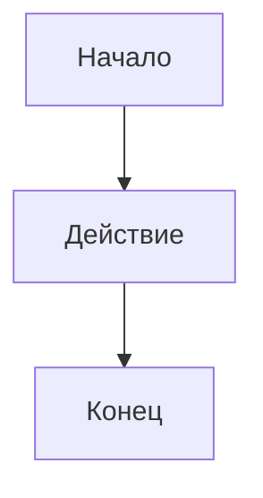

**Что здесь:**
- `flowchart TD` — тип диаграммы + направление
- `A`, `B`, `C` — ID узлов (латиница, короткие)
- `[текст]` — форма узла
- `-->` — стрелка

## 2. Направление (Direction)

| Код | Что значит |
|-----|-----------|
| `TD` | Top → Down (сверху вниз) — **основное для алгоритмов** |
| `TB` | Top → Bottom (то же самое, что TD) |
| `LR` | Left → Right (слева направо) |
| `RL` | Right → Left |
| `BT` | Bottom → Top |

**Совет:** для блок-схем всегда `TD`. Для длинных линейных цепочек (без ветвлений) — `LR`.

## 3. Формы узлов

| Форма | Код | Применение |
|-------|-----|-----------|
| Прямоугольник | `A[Текст]` | Обычное действие / процесс |
| Скруглённый | `A(Текст)` | Начало / конец (альтернатива) |
| Ромб | `A{Условие?}` | **Ветвление (if)** |
| Стадион | `A([Текст])` | **Начало / конец** (рекомендую) |
| Круг | `A((Текст))` | Точка соединения |
| Параллелограмм | `A[/Текст/]` | **Ввод / вывод (input/print)** |
| Цилиндр | `A[(База)]` | Данные / массив |
| Двойной круг | `A(((Текст)))` | Конец (альтернатива) |
| Шестиугольник | `A{{Текст}}` | Подготовка |

**Для задач Златопольского хватит 5 форм:**
- `([Начало])` / `([Конец])` — начало и конец
- `[Действие]` — вычисление, присваивание
- `[/Ввод/]` / `[/Вывод/]` — input() и print()
- `{Условие?}` — if / while

**Пример:**

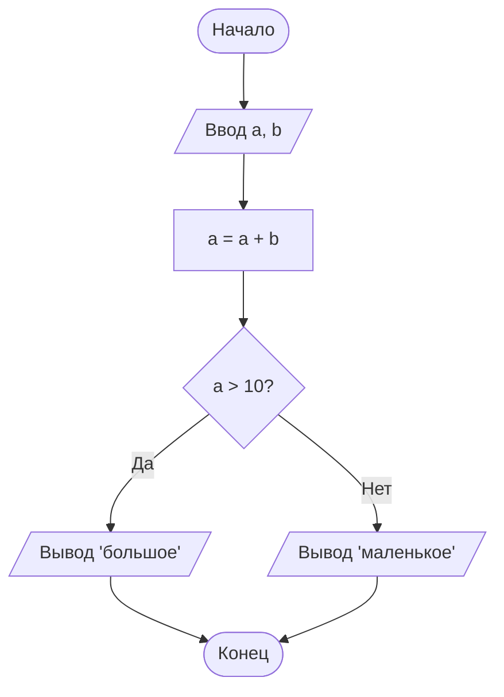

## 4. Стрелки (связи)

| Код | Вид |
|-----|-----|
| `A --> B` | Обычная стрелка |
| `A --- B` | Линия без стрелки |
| `A -.-> B` | Пунктирная стрелка |
| `A ==> B` | Толстая стрелка |
| `A -->\|текст\| B` | Стрелка с подписью |
| `A -- текст --> B` | То же, другой синтаксис |

**Для ветвлений — обязательно с подписью:**

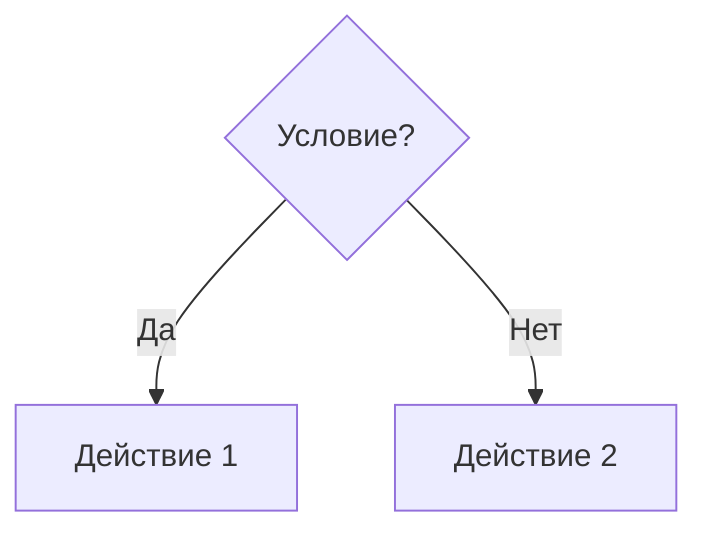

## 5. Комментарии

```
%% Это комментарий, Mermaid его игнорирует
```

## 6. Практические шаблоны

### Шаблон 1. Линейный алгоритм

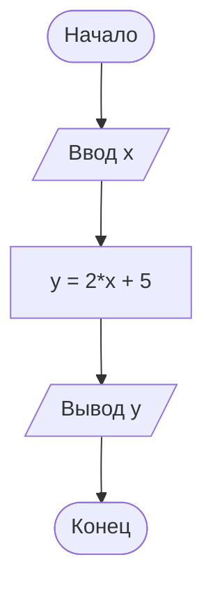

### Шаблон 2. Ветвление (if-else)

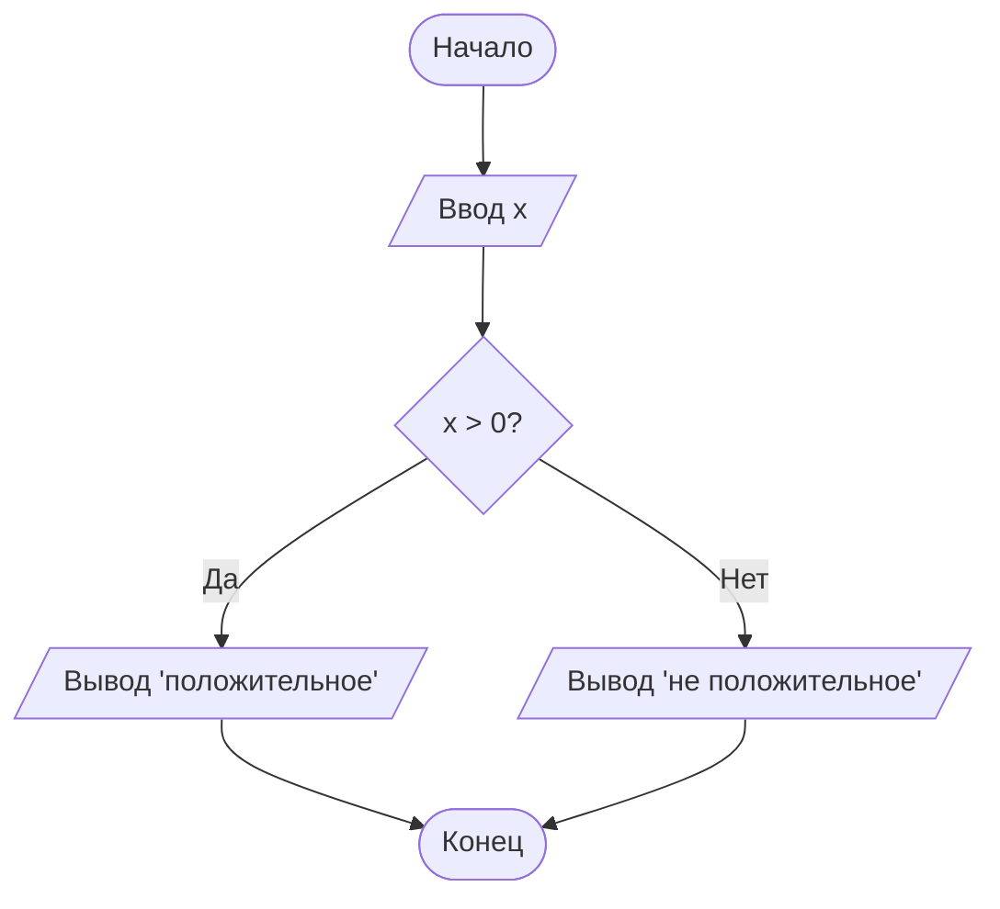

### Шаблон 3. Цикл

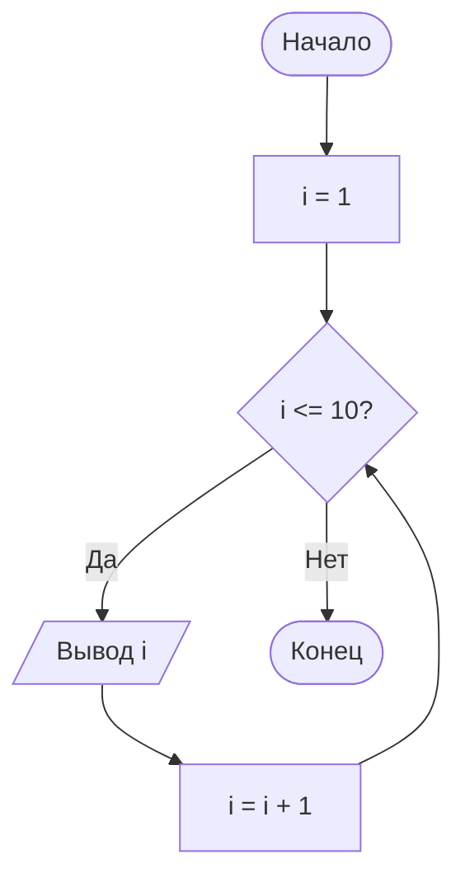

### Шаблон 4. Цикл с накоплением

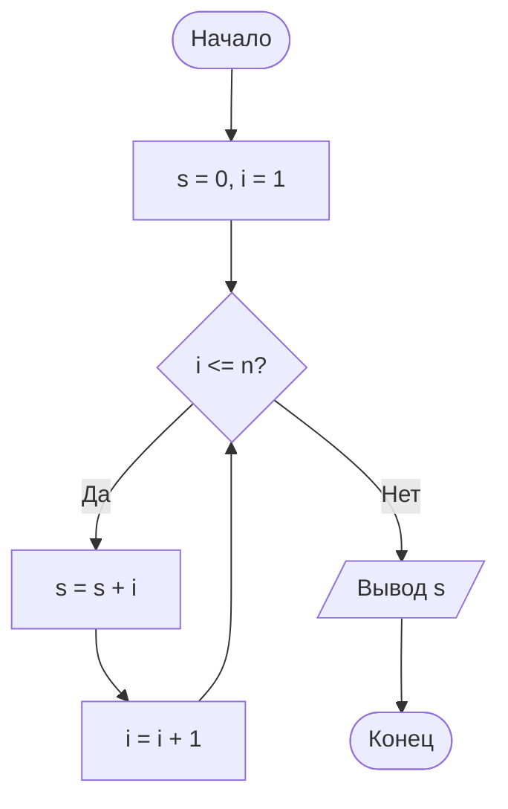

### Шаблон 5. Вложенные условия

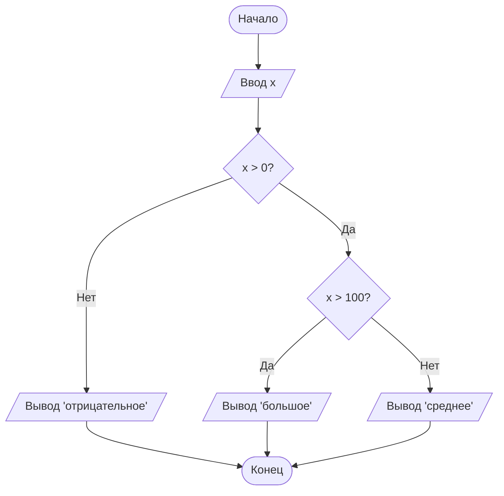

## 7. Подграфы (для сложных задач)

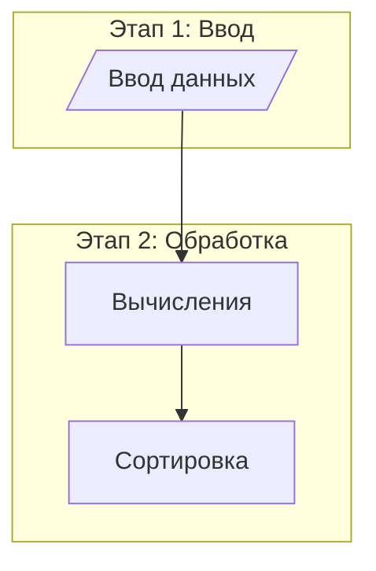

## 8. Стилизация (опционально)

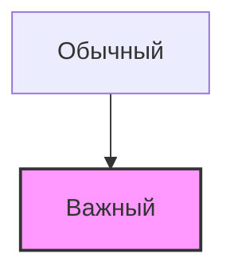

Для учебных задач обычно не нужно.

## 9. Частые ошибки

### Ошибка 1. Слово `end` строчными буквами

```
A[end]        ❌ сломает диаграмму
A[End]        ✅
A[END]        ✅
A[Конец]      ✅ (русское слово безопасно)
```

**Решение:** в русских схемах пишите `[Конец]` — проблемы не будет никогда.

### Ошибка 2. Скобки внутри текста узла

```
A[Действие (важное)]     ❌ Mermaid запутается
A["Действие (важное)"]   ✅ взять в кавычки
```

### Ошибка 3. Кириллица без кавычек

```
A[/Ввод x/]              ✅ работает
A{Условие?}              ✅ работает
```

Если сломается — оберните в кавычки: `A["Ввод x"]`.

### Ошибка 4. Забыли закрыть блок

Нужны три обратных кавычки в конце блока.

### Ошибка 5. Латиница vs кириллица в ID

```
Начало --> Конец       ❌ ID должны быть латиницей
A[Начало] --> B[Конец] ✅
```

**Правило:** ID узлов — латиница (`A`, `B`, `Start`), текст внутри — что угодно.

## 10. Мини-справочник по формам

```
[текст]       — прямоугольник (действие)
(текст)       — скруглённый
([текст])     — стадион (начало/конец) ← рекомендую
[[текст]]     — подпрограмма
[(текст)]     — база данных / массив
((текст))     — круг
(((текст)))   — двойной круг
{текст}       — ромб (условие) ← главное для if
{{текст}}     — шестиугольник
[/текст/]     — параллелограмм (ввод/вывод) ← для input/print
[/текст\]     — трапеция
>текст]       — асимметричная
```

## 11. Полный пример: НОД (Евклид)

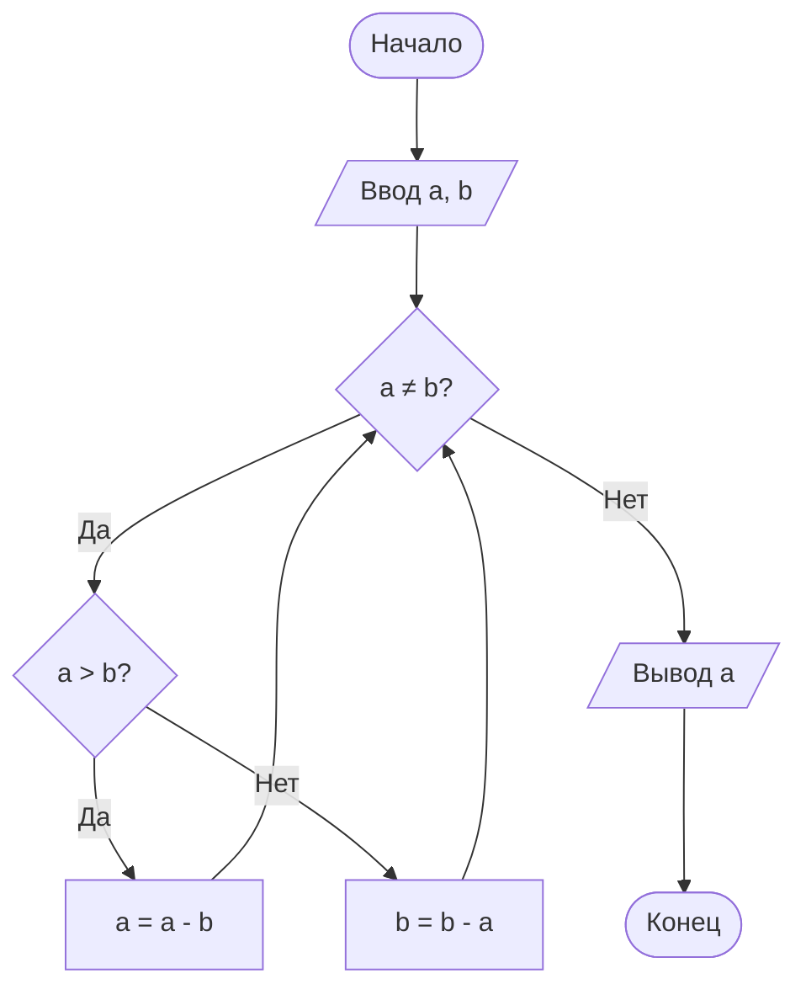

Это цикл с двумя ветвлениями. `Loop` — ромб, к нему возвращаются обе ветви.

## 12. Быстрая проверка

Открыли файл → `<leader>mk` → в браузере видно схему → **F5** для обновления после правок.

**Если схема не появилась:**
1. Блок начинается с ` ```mermaid ` (без пробела после бэктиков)
2. Блок **закрыт** ` ``` `
3. Слово `end` не в нижнем регистре
4. Обновите страницу F5

---

**Главное правило:** для 95% задач Златопольского хватит **пяти форм**:

```
([Начало]) / ([Конец])
[/Ввод/] / [/Вывод/]
[Действие]
{Условие?}
```

Не пытайтесь использовать все 30+ форм из документации — это для сложных блок-схем из ГОСТа.
