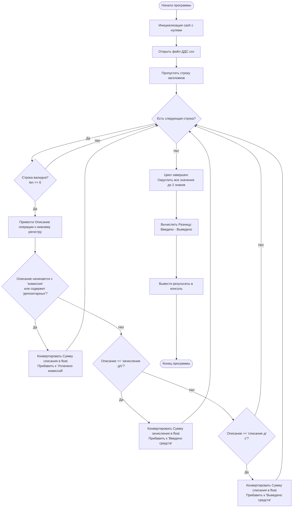

###### Этот файл подробно описывает алгоритм работы с данными из брокерского отчёта Таблица "Движение денежных средств"
###### Пример данных:
```csv
    Дата,Торговая площадка,Описание операции,Валюта,Сумма зачисления,Сумма списания
    22.02.2018,Фондовый рынок,Зачисление д/с,RUB,99 145.42,0.00
    22.02.2018,Фондовый рынок,Перевод д/с для проведения расчетов по клирингу,RUB,3 460.00,3 460.00
    26.02.2018,Фондовый рынок,Сделка от 22.02.2018,RUB,0.00,98 857.05
    26.02.2018,Фондовый рынок,Комиссия Биржи от 22.02.2018,RUB,0.00,2.06
    26.02.2018,Фондовый рынок,Комиссия Брокера оборотная от 22.02.2018,RUB,0.00,119.54
    26.02.2018,Фондовый рынок,Списание д/с,RUB,0.00,100.00
    26.02.2018,Фондовый рынок,Перевод д/с для проведения расчетов по клирингу,RUB,95 518.65,95 518.65
    02.03.2018,Фондовый рынок,Сделка от 01.03.2018,RUB,98 356.35,0.00
    02.03.2018,Фондовый рынок,Комиссия Биржи от 01.03.2018,RUB,0.00,1.34
```
# 1. Словесный алгоритм работы программы

    1. Инициализация: Создаётся результирующий словарь cash со стартовыми нулевыми значениями для трёх типов финансовых операций: зачислений, списаний и комиссий.
    2. Открытие файла: Безопасно открывается файл ДДС.csv в режиме чтения с кодировкой utf-8-sig (чтобы корректно обработать возможную метку BOM от Excel).
    3. Чтение и парсинг:
        • Создаётся объект csv.reader, который автоматически бьёт каждую строку по запятым на список элементов.
        • Первая строка (заголовки колонок) считывается и пропускается с помощью функции next().
    4. Итерация (Цикл): Программа начинает перебирать каждую оставшуюся строку файла:
        • Проверка на валидность: Если строка пустая или в ней меньше 6 колонок — она пропускается.
        • Выделение признака: Извлекается текст из 3-й колонки (индекс 2 — «Описание операции»), очищается от пробелов по краям и переводится в нижний регистр.
    5. Классификация операции (Ветвление):
        • Если описание начинается на "комиссия" или содержит "оплата депозитарных": Из 6-й колонки (индекс 5 — «Сумма списания») извлекается строка. Специальная функция очищает её от пробелов (включая неразрывные \xa0), меняет запятую на точку, переводит в число float и прибавляет к счетчику 'Уплачено комиссий'.
        • Если описание строго равно "зачисление д/с": Из 5-й колонки (индекс 4 — «Сумма зачисления») извлекается строка, конвертируется в число и прибавляется к счетчику 'Введено средств'.
        • Если описание строго равно "списание д/с": Из 6-й колонки (индекс 5 — «Сумма списания») извлекается строка, конвертируется в число и прибавляется к счетчику 'Выведено средств'.
        • Любые другие операции (клиринг, обычные сделки купли/продажи) игнорируются, так как они не меняют чистый баланс ввода/вывода средств.
    6. Округление и возврат: После завершения цикла все три накопительные суммы в словаре округляются до 2 знаков после запятой, и словарь возвращается из функции.
    7. Блок запуска: Вне функции рассчитывается чистая разница между вводом и выводом капитала, и все результаты выводятся на экран.

# 2. Блок-схема алгоритма на Mermaid


# 3. Код скрипта

```python
import csv
import pprint as p 

def cash_flow(filepath):
    '''Функция выделяет суммы зачислений, выводы средств и комиссии на счёте'''
    cash = {
        'Введено средств': 0.0,
        'Выведено средств': 0.0,
        'Уплачено комиссий': 0.0,
    }

    with open(filepath, mode='r', encoding='utf-8-sig') as file:
        # Стандартный разделитель — запятая
        reader = csv.reader(file)
        
        # Пропускаем строку заголовков
        next(reader, None) 

        for line in reader:
            # Защита от пустых строк
            if not line or len(line) < 6:
                continue

            # Очищаем описание операции для проверки условий
            operation = line[2].strip().lower()

            # Функция для безопасного перевода строки с пробелами/запятыми в float
            def to_float(val):
                cleaned = val.strip().replace(" ", "").replace("\xa0", "").replace(",", ".")
                return float(cleaned) if cleaned else 0.0

            # 1. КОМИССИИ И ДЕПОЗИТАРНЫЕ УСЛУГИ
            # Проверяем, начинается ли строка с "комиссия" или содержит оплату услуг
            if operation.startswith('комиссия') or 'оплата депозитарных' in operation:
                # Сумма списания за комиссию находится в последней колонке (индекс 5)
                cash['Уплачено комиссий'] += to_float(line[5])

            # 2. ВВЕДЕНО СРЕДСТВ
            elif operation == 'зачисление д/с':
                cash['Введено средств'] += to_float(line[4])

            # 3. ВЫВЕДЕНО СРЕДСТВ
            elif operation == 'списание д/с':
                cash['Выведено средств'] += to_float(line[5])

    # Округляем результаты для исключения погрешностей float
    for key in cash:
        cash[key] = round(cash[key], 2)

    return cash

if __name__ == '__main__':
    # Пример запуска
    result = cash_flow('ДДС.csv')
    p.pprint(result, width=120)

    difference = result['Введено средств'] - result['Выведено средств']
    print(f"\nРазница - {difference:.2f}")
```

# 4. Подробное описание ключевых участков кода

#### 4.1  Безопасное чтение финансовых чисел (to_float)

```python
#def to_float(val):
#    cleaned = val.strip().replace(" ", "").replace("\xa0", "").replace(",", ".")
#    return float(cleaned) if cleaned else 0.0
```
• Зачем это нужно: Прямая конвертация вроде float("99 145,42") в Python вызовет критическую ошибку (ValueError).
• Как работает: Метод .strip() убирает случайные пробелы по краям. Первый .replace(" ", "") убирает обычные 
  пробелы-разделители тысяч. Второй .replace("\xa0", "") удаляет скрытые неразрывные пробелы, которые часто генерируются 
  при экспорте отчетов брокера в CSV/Excel. Третий .replace(",", ".") заменяет российскую десятичную запятую на стандартную 
  для Python точку.

#### 4.2    Логика ветвления для комиссий

```python
#if operation.startswith('комиссия') or 'оплата депозитарных' in operation:
#    cash['Уплачено комиссий'] += to_float(line[5])
```
• operation.startswith('комиссия'): Метод возвращает True для строк вида "комиссия биржи..." и "комиссия брокера...", 
  избавляя от необходимости писать громоздкие точные сравнения или сложные регулярные выражения.
• line[5]: Важно, что сумма расхода за комиссию всегда считывается из 6-й колонки («Сумма списания»), в то время как в 
  5-й колонке («Сумма зачисления») в этот момент стоит 0.00.

#### 4.3    Игнорирование внутреннего оборота

  Строки отчета, описывающие клиринг (Перевод д/с для проведения расчетов...) или покупку активов (Сделка от...), не попадают
  ни под одно из условий if/elif. Скрипт их просто пропускает. Это абсолютно правильно, так как при покупке акций или клиринге
  деньги со счета не выводятся внешнему миру и не вводятся извне — они просто меняют свою форму внутри портфеля.


  
