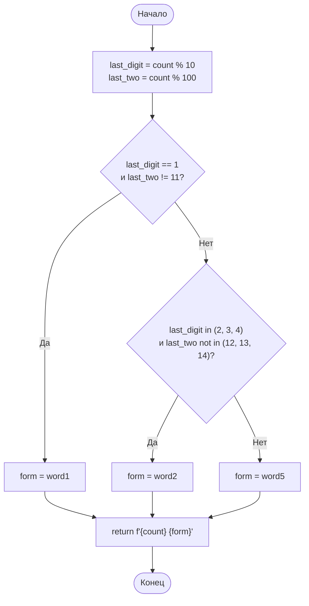

# Задача написать функцию, которая возвращает правильную форму слова для числа count.

## Условие

    Правила: 1, 21, 31... → «акция»; 2-4, 22-24... → «акции»; 5-20, 25-30... → «акций»

#### Логика:

    1, 21, 31... (оканчивается на 1, кроме 11) → word1.
    2-4, 22-24... (оканчивается на 2, 3, 4, кроме 12-14) → word2.
    Остальные → word5.

## Словесный алгоритм
#### Часть 1: Описание функции pluralize
1. Определяем функцию pluralize с 4 параметрами: count, word1, word2 и word5
2. Документируем функцию (строка документации)
3. Объявляем переменную для последней цифры любого числа - last_digit
4. Объявляем переменную для двух последних цифр любого числа - last_two
5. Запускаем условие: if last_digit == 1 and last_two != 11, то form = word1
6. Если условие 1 не выполнено, проверяем: elif last_digit in (2, 3, 4) and last_two not in (12, 13, 14), то form = word2
7. Во всех других случаях form = word5
8. Функция возвращает строку: return f"{count} {form}"

### Блок-схема:



```python
def pluralize(count, word1, word2, word5):
    """Возвращает правильную форму слова для числа count."""
    last_digit = count % 10
    last_two = count % 100

    if last_digit == 1 and last_two != 11:
        form = word1
    elif last_digit in (2, 3, 4) and last_two not in (12, 13, 14):
        form = word2
    else:
        form = word5

    return f"{count} {form}"


# Тест:
test_counts = range(0, 23)
for num in test_counts:
    res = pluralize(num, "слово", "слова", "слов")
    print(res)
```
