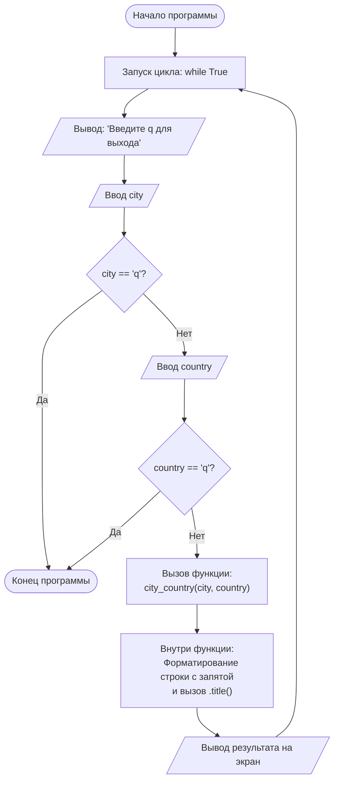

# Упражнение 8.6. Названия городов
## Условие:

    Напишите функцию city_country(), которая получает название города и страну. Функция 
    должна возвращать строку в формате: "Santiago, Chile".
    Вызовите свою функцию по крайней мере для трех пар «город — страна» и выведите 
    возвращенное значение.

## Словесный алгоритм:

#### Часть 1: Описание функции city_country
1. Определяем функцию city_country с двумя параметрами: city и country.
2. Документируем функцию (строка документации).
3. Формируем строку в формате "{город}, {страна}" и сохраняем в переменную.
4. Возвращаем эту строку, преобразовав первые буквы слов в заглавные (.title()).
#### Часть 2: Основная программа (Цикл)
5. Запускаем бесконечный цикл while True.
6. Выводим пользователю инструкцию (например: "Введите 'q' для выхода").
7. Запрашиваем у пользователя название города.
8. Проверяем: если введено 'q', прерываем цикл (break).
9. Запрашиваем у пользователя название страны.
10. Проверяем: если введено 'q', прерываем цикл (break).
11. Передаем введенные данные в функцию city_country().
12. Выводим результат работы функции на экран.

## Блок-схема



```python
# 1-4. Объявление функции
def city_country(city, country):
    """Возвращает форматированную строку 'Город, Страна'."""
    full_string = f"{city}, {country}"
    return full_string.title()

# 5. Бесконечный цикл
while True:
    # 6. Инструкция пользователю
    print("\n(Введите 'q' в любой момент для выхода)")
    
    # 7-8. Запрос города и проверка
    city = input("Введите название города: ").strip()
    if city.lower() == 'q':
        break
        
    # 9-10. Запрос страны и проверка
    country = input("Введите название страны: ").strip()
    if country.lower() == 'q':
        break
        
    # 11-12. Вызов и вывод на экран
    formatted_name = city_country(city, country)
    print(f"Результат: {formatted_name}")

print("Программа завершена.")
```
